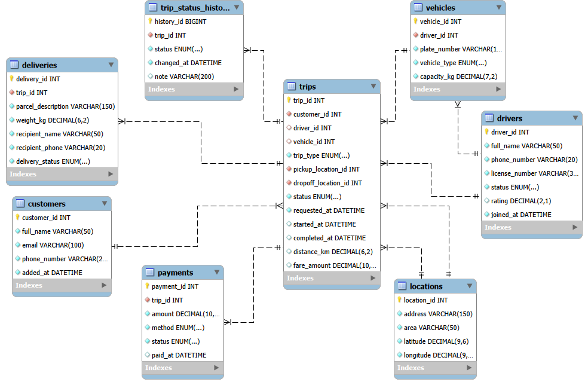

# Azeez-Adeyinka-301926730-MIT8103-Advance-Database-System-practical-


**Student:** Azeez Adeyinka

**Session:** 2026/2027, First Semester Continuous Assessment
**Assessment:** Individual Practical Database Portfolio 
**StudentID** 301926730
**Student email** a.azeez6730@miva.edu.ng
**Organisation** Insightmove
**GitHub repository**: https://github.com/AzeezAdeyinka/Azeez-Adeyinka-301926730-MIT8103-Advance-Database-System-practical-

## Contents

1. [Selected organisation](#1-selected-organisation-insightmove)
2. [Technologies and repository structure](#2-technologies-and-repository-structure)
3. [Portfolio 1: Database Design and Modelling](#3-portfolio-1-database-design-and-modelling)
4. [Portfolio 2: Query Processing and Optimisation](#4-portfolio-2-query-processing-and-optimisation)
5. [Portfolio 3: Transactions and Concurrency](#5-portfolio-3-transactions-and-concurrency)
6. [Portfolio 4: NoSQL and Advanced Data Models](#6-portfolio-4-nosql-and-advanced-data-models)
7. [Portfolio 5: Distributed and Cloud Database Exercise](#7-portfolio-5-distributed-and-cloud-database-exercise)
8. [Test data, individual work and AI use declaration](#9-test-data-individual-work-and-ai-use-declaration)


---

## 1. Selected Organisation: InsightMove

| Item | Description |
|---|---|
| Organisation | **InsightMove**, a simulated Lagos-based ride-hailing and goods-delivery platform running both services on the same fleet |
| Case study type | Ride-hailing / Logistics System (from the assessment brief) |
| What the system does | Customers request a trip (a ride or a delivery). The nearest suitable driver and vehicle is assigned, and the trip moves through status stages until it is completed and paid. |
| Users of the database | Customers, drivers, dispatchers and operations staff, finance staff, data analysts |
| Major data stored | Customers, drivers, vehicles, locations, trips, delivery details, trip status history, payments |
| Key operations | Request and match a trip, update trip and delivery status, track a delivery, record payment, calculate driver earnings, report on delivery times and cancellations |

The same case study is used consistently in all five portfolios.

## 2. Technologies and Repository Structure

| Purpose | Tool |
|---|---|
| Relational database | MySQL 8.0 (InnoDB) and MySQL Workbench |
| Document database | MongoDB 9.0.4 (local), MongoDB Compass and mongosh |
| Cloud database | MongoDB Atlas, free M0 tier on AWS (EU_WEST_3, Paris) |
| Version control | Git and GitHub |
| AI assistance | Claude (Anthropic) |

```
advanced-database-portfolio/
├── portfolio-1-database-design/            
├── portfolio-2-query-optimisation/         
├── portfolio-3-transactions-concurrency/   
├── portfolio-4-nosql/                      
├── portfolio-5-distributed-cloud/          
└── README.md                               this file
```

| Portfolio | Key result |
|---|---|---|
| 1. Database Design and Modelling | Eight-table MySQL schema in third normal form, with constraints tested by valid and invalid inserts |
| 2. Query Processing and Optimisation | Four indexes cut the rows read by each performance query from about 7,500 to 7,800 down to between 70 and 2,943 |
| 3. Transactions and Concurrency | Commit, rollback, two isolation levels, a double-booking race condition, and a `FOR UPDATE` fix |
| 4. NoSQL and Advanced Data Models | Eight MongoDB collections matching MySQL; an index cut documents examined from 8,000 to 724 |
| 5. Distributed and Cloud Database | Three-node Atlas replica set, write concern and read preference tests, and a documented sharding design |

---

## 3. Portfolio 1: Database Design and Modelling

### 3.1 ER diagram



| Relationship | Type | How it is enforced |
|---|---|---|
| customers → trips | One-to-many | `trips.customer_id` foreign key |
| drivers → vehicles | One-to-many | `vehicles.driver_id` foreign key |
| drivers → trips | One-to-many | `trips.driver_id` foreign key (nullable until accepted) |
| vehicles → trips | One-to-many | `trips.vehicle_id` foreign key (nullable until assigned) |
| locations → trips | One-to-many (twice) | `pickup_location_id` and `dropoff_location_id` foreign keys |
| trips → deliveries | One-to-one (optional) | `deliveries.trip_id` is a foreign key and `UNIQUE` |
| trips → trip_status_history | One-to-many | `trip_status_history.trip_id` foreign key |
| trips → payments | One-to-many | `payments.trip_id` foreign key |

### 3.2 Tables

#### customers
| Column | Type | Constraints | Purpose |
|---|---|---|---|
| customer_id | INT | PRIMARY KEY, AUTO_INCREMENT | Unique ID generated by MySQL |
| full_name | VARCHAR(50) | NOT NULL | Customer's name |
| email | VARCHAR(100) | UNIQUE, NOT NULL | Contact email |
| phone_number | VARCHAR(20) | UNIQUE, NOT NULL | Contact number |
| added_at | DATETIME | NOT NULL, DEFAULT CURRENT_TIMESTAMP | When the customer signed up |

#### drivers
| Column | Type | Constraints | Purpose |
|---|---|---|---|
| driver_id | INT | PRIMARY KEY, AUTO_INCREMENT | Unique ID generated by MySQL |
| full_name | VARCHAR(50) | NOT NULL | Driver's name |
| phone_number | VARCHAR(20) | UNIQUE, NOT NULL | Contact number |
| license_number | VARCHAR(30) | UNIQUE, NOT NULL | Driver's licence, one per driver |
| status | ENUM('available','on_trip','offline') | NOT NULL, DEFAULT 'offline' | Current availability |
| rating | DECIMAL(2,1) | NULL, CHECK 1.0 to 5.0 | Average rating; empty for new drivers |
| joined_at | DATETIME | NOT NULL, DEFAULT CURRENT_TIMESTAMP | When the driver joined the platform |

#### vehicles
| Column | Type | Constraints | Purpose |
|---|---|---|---|
| vehicle_id | INT | PRIMARY KEY, AUTO_INCREMENT | Unique ID |
| driver_id | INT | NOT NULL, FOREIGN KEY → drivers | Owner of the vehicle |
| plate_number | VARCHAR(15) | UNIQUE, NOT NULL | Registration plate |
| vehicle_type | ENUM('bike','car','van') | NOT NULL | Type of vehicle |
| capacity_kg | DECIMAL(7,2) | NOT NULL, CHECK > 0 | Load capacity |

#### locations
| Column | Type | Constraints | Purpose |
|---|---|---|---|
| location_id | INT | PRIMARY KEY, AUTO_INCREMENT | Unique ID |
| address | VARCHAR(150) | NOT NULL | Street address |
| area | VARCHAR(50) | NOT NULL | Area, e.g. Ikeja or Lekki |
| latitude | DECIMAL(9,6) | NOT NULL, CHECK -90 to 90 | Coordinate |
| longitude | DECIMAL(9,6) | NOT NULL, CHECK -180 to 180 | Coordinate |

#### trips
| Column | Type | Constraints | Purpose |
|---|---|---|---|
| trip_id | INT | PRIMARY KEY, AUTO_INCREMENT | Unique ID |
| customer_id | INT | NOT NULL, FOREIGN KEY → customers | Who requested the trip |
| driver_id | INT | NULL, FOREIGN KEY → drivers | Assigned driver |
| vehicle_id | INT | NULL, FOREIGN KEY → vehicles | Assigned vehicle |
| trip_type | ENUM('ride','delivery') | NOT NULL | Passenger or goods |
| pickup_location_id | INT | NOT NULL, FOREIGN KEY → locations | Pickup place |
| dropoff_location_id | INT | NOT NULL, FOREIGN KEY → locations | Drop-off place |
| status | ENUM('requested','accepted','in_progress','completed','cancelled') | NOT NULL, DEFAULT 'requested' | Current stage |
| requested_at | DATETIME | NOT NULL, DEFAULT CURRENT_TIMESTAMP | When requested |
| started_at | DATETIME | NULL | When the trip began |
| completed_at | DATETIME | NULL | When the trip ended |
| distance_km | DECIMAL(6,2) | NULL | Distance travelled |
| fare_amount | DECIMAL(10,2) | NULL, CHECK >= 0 | Fare charged |

Table-level rule: `CHECK (pickup_location_id <> dropoff_location_id)`.

#### deliveries
| Column | Type | Constraints | Purpose |
|---|---|---|---|
| delivery_id | INT | PRIMARY KEY, AUTO_INCREMENT | Unique ID |
| trip_id | INT | NOT NULL, UNIQUE, FOREIGN KEY → trips (ON DELETE CASCADE) | The delivery trip |
| parcel_description | VARCHAR(150) | NOT NULL | What is being delivered |
| weight_kg | DECIMAL(6,2) | NOT NULL, CHECK > 0 | Parcel weight |
| recipient_name | VARCHAR(50) | NOT NULL | Who receives it |
| recipient_phone | VARCHAR(20) | NOT NULL | Recipient contact |
| delivery_status | ENUM('pending','picked_up','in_transit','delivered','failed') | NOT NULL, DEFAULT 'pending' | Parcel status |

#### trip_status_history
| Column | Type | Constraints | Purpose |
|---|---|---|---|
| history_id | BIGINT | PRIMARY KEY, AUTO_INCREMENT | Unique ID |
| trip_id | INT | NOT NULL, FOREIGN KEY → trips (ON DELETE CASCADE) | The trip |
| status | ENUM (same five values as trips) | NOT NULL | Status at that moment |
| changed_at | DATETIME | NOT NULL, DEFAULT CURRENT_TIMESTAMP | When it changed |
| note | VARCHAR(200) | NULL | Optional comment |

#### payments
| Column | Type | Constraints | Purpose |
|---|---|---|---|
| payment_id | INT | PRIMARY KEY, AUTO_INCREMENT | Unique ID |
| trip_id | INT | NOT NULL, FOREIGN KEY → trips | The trip paid for |
| amount | DECIMAL(10,2) | NOT NULL, CHECK > 0 | Amount paid |
| method | ENUM('cash','card','transfer','wallet') | NOT NULL | Payment method |
| status | ENUM('pending','successful','failed','refunded') | NOT NULL, DEFAULT 'pending' | Payment state |
| paid_at | DATETIME | NULL | When payment succeeded |

### 3.3 Design choices

- **Surrogate primary keys:** every table uses an auto-generated `_id`. Phone numbers and emails can change, and changing a key would mean updating every table that references it.
- **UNIQUE and NOT NULL on contact details:** dispatchers must be able to reach every customer and driver, and a repeated phone or email would suggest a duplicate account.
- **No address on customers:** customers are picked up and delivered to many places, so places live in `locations` and are referenced by trips.
- **VARCHAR lengths:** phone numbers need at most about 14 characters, so 20 is enough; emails can be long, so 100 is safer.
- **ENUM for fixed value sets:** status, trip type, vehicle type and payment method accept only the listed values.
- **Nullable columns in trips:** driver, vehicle, start time, completion time, distance and fare are unknown when a customer first requests a trip.
- **Separate deliveries table:** parcel fields apply only to delivery trips, so keeping them out of `trips` avoids empty columns on every ride.
- **Separate trip_status_history:** `trips.status` is overwritten at each change; the history table keeps the full audit trail.
- **ON DELETE CASCADE only on deliveries and history:** these records mean nothing without their trip. Payments have no cascade, so a trip with payments cannot be deleted by accident.
- **DECIMAL for money and coordinates:** exact values, with no rounding errors as with FLOAT or truncation as with INT.
- **Known limitation:** nothing stops a trip from using a vehicle that belongs to a different driver. A composite foreign key `(vehicle_id, driver_id)` could enforce this.

### 3.4 Normalisation

I explained normalisation by starting from a single unnormalised sheet with one row per trip, holding customer, driver, vehicle, address, parcel and payment details together. It has three problems: an **update anomaly** (a customer's phone number repeated on every trip must be changed everywhere), an **insertion anomaly** (a driver cannot be recorded until they have a trip) and a **deletion anomaly** (deleting a customer's only trip deletes the customer's details).

- **1NF:** the status history held several values in one cell, so it became its own table, `trip_status_history`, with one row per change.
- **2NF and 3NF:** attributes that depend on something other than the trip moved to their own tables: customer details to `customers`, driver details to `drivers`, vehicle details to `vehicles`, addresses to `locations`, and parcel and payment details to `deliveries` and `payments`. Every non-key column now depends only on its own table's key.
- **Deliberate choices:** `locations` is used twice by `trips` (pickup and drop-off), derived totals such as earnings are not stored because they can be calculated, and status is kept in both `trips` (current) and `trip_status_history` (audit trail) on purpose.


### 3.5 Testing and evidence

Each table was created in MySQL 8.0 and tested with valid and invalid inserts. Screenshots are in `portfolio-1-database-design/screenshots/`.

| Table | Test | Result | What it proves |
|---|---|---|---|
| customers | Valid insert | ID and `added_at` generated automatically | Defaults and `AUTO_INCREMENT` work |
| customers | Insert without `phone_number` | **Error 1364**, no default value | `NOT NULL` rejects a missing phone number |
| customers | Insert with a repeated email | **Error 1062**, duplicate entry | `UNIQUE` rejects a repeated email |
| trips | Insert with `customer_id` 999 | **Error 1452**, foreign key failure | A trip needs an existing customer |
| trips | Insert before locations existed | **Error 1452** on `dropoff_location_id` | The foreign key on locations works |
| other tables | ENUM, CHECK, UNIQUE and foreign key tests | See the screenshots in the folder | Constraints reject invalid data |


### 3.6 Challenges and what I learned

My first `CREATE TABLE` used curly braces and put the type before the column name, so I learned the correct MySQL syntax. I also learned to tell the errors apart: 1136 means the number of values does not match the number of columns, 1364 means a required column has no value, 1062 means a unique value already exists, and 1452 means a foreign key points at a row that does not exist. I chose each constraint to protect a business rule, not just to make the table run.

---

## 4. Portfolio 2: Query Processing and Optimisation

### 4.1 Test data

The database was loaded with generated data that mimics a Lagos ride-hailing and delivery platform : 1,000 customers, 120 drivers, 120 vehicles, 60 locations, 8,000 trips, 3,222 deliveries, 30,884 status history rows and 7,525 payments. All dates fall in 2026. Names, phone numbers and addresses are generated by artificial intelligence and are fictional.

### 4.2 Queries and results (`queries.sql`)

| Query | Purpose | Tables used |
|---|---|---|
| Q1 | List all customers | customers |
| Q2 | List completed trips | trips |
| Q3 | Drivers rated above 4.5, highest first | drivers |
| Q4 | Number of trips of each type | trips |
| Q5 | Completed trips with the customer's name | trips, customers |
| Q6 | Total earnings per driver | drivers, trips |
| Q7 | Customers with more than one completed trip | customers, trips |
| Q8 | Average trip duration per trip type | trips |
| Q9 | Delivery report with the driver who handled each parcel (`LEFT JOIN` keeps deliveries with no driver yet) | deliveries, trips, drivers |
| Q10 | Completed trips with no successful payment | trips, payments |

### 4.3 Performance queries

| ID | Query |
|---|---|
| P1 | All cancelled trips |
| P2 | Number of trips requested in July 2026 |
| P3 | Completed delivery trips per driver |
| P4 | Top 20 completed fares since 1 September 2026, with customer name |
| P5 | Failed card payments |

### 4.4 Indexes added (`indexes.sql`)

```sql
CREATE INDEX idx_trips_status_type_driver ON trips (status, trip_type, driver_id);
CREATE INDEX idx_trips_requested_at ON trips (requested_at);
CREATE INDEX idx_trips_fare ON trips (fare_amount);
CREATE INDEX idx_payments_method_status ON payments (method, status);
```

| Index | Helps | Reason |
|---|---|---|
| idx_trips_status_type_driver | P1, P3 | Filters on `status` and `trip_type`; `driver_id` is included so the query is answered from the index alone |
| idx_trips_requested_at | P2 | Range filter on a date column |
| idx_trips_fare | P4 | Returns the highest fares first, so MySQL stops after 20 rows and needs no sort |
| idx_payments_method_status | P5 | Filters on both `method` and `status` |

### 4.5 Before and after

Measured with `EXPLAIN` and `EXPLAIN ANALYZE`. "Before" has only the primary and foreign key indexes.

| Query | Before: plan | Before: rows | Before: time | After: plan | After: rows | After: time |
|---|---|---|---|---|---|---|
| P1 | Table scan (ALL) | 7,774 | 6.69 ms | Index lookup | 724 | 2.43 ms |
| P2 | Table scan (ALL) | 7,774 | 4.23 ms | Covering index range scan | 1,126 | 1.42 ms |
| P3 | Full foreign key index read | 7,774 | 7.19 ms | Covering index lookup | 2,943 | 2.81 ms |
| P4 | Table scan + filesort | 7,774 | 2.68 ms | Reverse index scan, no sort | 70 | 0.44 ms |
| P5 | Table scan (ALL) | 7,505 | 2.39 ms | Index lookup | 124 | 0.42 ms |

### 4.6 Performance analysis

- Before indexing, every performance query read almost the whole table (about 7,500 to 8,000 rows) even when it needed a small part. After indexing, each query reads only the rows it needs: for example P5 went from about 7,500 rows to 124.
- P4 shows the largest gain. The index on `fare_amount` lets MySQL read fares from highest to lowest and stop after 20 matches, so it read 70 index entries and the sort (`Using filesort`) disappeared.
- P2 and P3 use covering indexes: the index contains every column the query needs, so MySQL never reads the table itself.
- A multi-column index also serves queries that filter on only its first column. P1 filters on `status` alone and still used `idx_trips_status_type_driver`, so no separate index on `status` was needed.
- An index on `status` alone would be a weak choice. `SHOW INDEX FROM trips` shows a cardinality of only 5 for `status`, and most trips share the same value (91% are `completed`), so for those values the index would point at nearly every row and save almost nothing.
- Time differences are small because the table has only 8,000 rows. The reduction in rows read is the clearer evidence, and the gap would grow with a larger table.
- Indexes are not free: each one uses storage and has to be updated on every insert, update or delete of the indexed columns, so only the indexes that serve real queries were added.

### 4.7 Evidence

| Evidence | Location |
|---|---|
| Query results Q1 to Q10 | `portfolio-2-query-optimisation/` |
| `EXPLAIN` plans before and after, P1 to P5 | `portfolio-2-query-optimisation/` |
| `EXPLAIN ANALYZE` timings | `portfolio-2-query-optimisation/` |
| `SHOW INDEX FROM trips` and `payments` | `portfolio-2-query-optimisation/` |

### 4.8 Challenges and what I learned

My first attempt to create the indexes ran only the last line of the script, so I got `OK` from `ANALYZE TABLE` but no index existed until I checked with `SHOW INDEX`, and I learned to select and execute statements deliberately. Workbench showed `0.000 sec` for my queries, so I used `EXPLAIN ANALYZE` to get timings with decimals. I learned to read the `type`, `key` and `rows` columns of a plan: `ALL` with `key = NULL` means a full scan, and an index lookup with a small `rows` means the index is doing its job.

---

## 5. Portfolio 3: Transactions and Concurrency

All tests were run in MySQL Workbench with InnoDB. Exercises that need two users used **two separate query tabs**, because each tab is its own database session. The statements are in `portfolio-3-transactions-concurrency/transactions.sql`.

### 5.1 Commit

**Scenario:** a dispatcher assigns a driver to a requested trip. Three changes must succeed together: the trip receives the driver and vehicle and its status becomes `accepted`, the driver's status becomes `on_trip`, and a row is added to `trip_status_history`.

I ran the three statements inside `START TRANSACTION` and finished with `COMMIT`. Afterwards the trip showed `accepted` with its driver and vehicle, the driver showed `on_trip`, and the history table held the new row. `COMMIT` makes all the changes permanent and visible to other sessions at the same moment. If the connection had dropped before `COMMIT`, MySQL would have cancelled the whole transaction.

### 5.2 Rollback

**Scenario:** a transaction fails halfway.

| Step | Statement | Result |
|---|---|---|
| 1 | `START TRANSACTION` | Transaction opened |
| 2 | `UPDATE drivers SET status = 'on_trip'` for driver 3 | Inside the transaction, a `SELECT` shows `on_trip` |
| 3 | `INSERT` into `trip_status_history` with the status `'lost'` | **Error 1265: Data truncated for column 'status'**, because `'lost'` is not an allowed value |
| 4 | `ROLLBACK` | Pending change undone |
| 5 | `SELECT` driver 3 | Back to `available` |

The failed `INSERT` did not cancel the transaction: only that statement failed, and the earlier `UPDATE` stayed pending until I ran `ROLLBACK`. Had I run `COMMIT` instead, the driver would have been left marked as on a trip with no history record. `COMMIT` saves a transaction's changes and `ROLLBACK` discards them.

### 5.3 Isolation levels

Isolation decides what one transaction can see of changes made by another. I used Session A (reader) and Session B (writer) on driver 5's rating, whose original value was 4.0.

**REPEATABLE READ (MySQL's default)**

| Step | Session | Result |
|---|---|---|
| A starts a transaction and reads the rating | A | 4.0 |
| B updates the rating to 3.0 and commits | B | |
| A reads again, still inside its transaction | A | 4.0 |
| A commits and reads again | A | 3.0 |

A kept seeing the data as it was when its transaction began, even though B had committed a change. This consistent snapshot prevents **non-repeatable reads**.

**READ COMMITTED**

| Step | Session | Result |
|---|---|---|
| A starts a transaction and reads the rating | A | 3.0 |
| B updates the rating to 4.0 and commits | B | |
| A reads again, still inside its transaction | A | 4.0 |

At this weaker level, A sees every change B has committed as soon as it happens, so the same query returns different values inside one transaction. A report that reads the same driver twice could print two different ratings.


### 5.4 Concurrency problem: a race condition

**Scenario:** two dispatchers try to assign the same available driver (driver 3) to two different requested trips (7990 and 7991) at the same time.

1. Both sessions started a transaction and read driver 3 as `available`.
2. Session A assigned trip 7990 to driver 3, set the driver to `on_trip` and committed.
3. Session B, still believing the driver was free, assigned trip 7991 to driver 3 and committed.

Both transactions succeeded and neither produced an error, so driver 3 ended up on two trips at once. Each transaction was correct on its own, but together they broke the business rule that a driver has one active trip. The outcome depended on the timing of the two sessions, which is why this is called a **race condition**.

### 5.5 Control mechanism: row locking with `SELECT ... FOR UPDATE`

1. Session A started a transaction and read driver 3 with `FOR UPDATE`, which locked the row.
2. Session B ran the same statement and had to wait, because A held the lock.
3. Session A assigned trip 7990 and committed, which released the lock.
4. Session B's read then completed and showed driver 3 as `on_trip`, so B rolled back instead of assigning the driver.

**Result:** trip 7990 belongs to driver 3 and trip 7991 stays `requested`. No double booking.

`FOR UPDATE` turns the "read, then decide, then write" sequence into one protected step. Only one transaction at a time can read the row with the intention of changing it, so the second one always sees the result of the first. The trade-off is that locks make other sessions wait, and a session that waits too long fails with a lock timeout (Error 1205), so transactions that hold locks should be kept short.

### 5.6 Evidence

| Test | Location |
|---|---|
| Commit: trip, driver and history after the transaction | `portfolio-3-transactions-concurrency/` |
| Rollback: in-transaction read, error 1265, read after rollback | `portfolio-3-transactions-concurrency/` |
| Isolation: A's reads under both levels | `portfolio-3-transactions-concurrency/` |
| Race condition: both trips on driver 3 | `portfolio-3-transactions-concurrency/` |
| Lock: A's read, B waiting, B's result, final check | `portfolio-3-transactions-concurrency/` |

### 5.7 Challenges and what I learned

One query tab is one session, so I needed two tabs to show isolation and concurrency. I once ran a placeholder (`ORIGINAL_RATING`) as if it were a value and got Error 1054, which taught me to replace placeholders with real values. I found that a failed statement does not cancel a whole transaction, and that a race condition can pass without any error unless a lock prevents it.

---

## 6. Portfolio 4: NoSQL and Advanced Data Models

**Type:** document model (MongoDB 9.0.4, local). Database name: `insightmove_nosql`.

### 6.1 NoSQL model

The model follows the MySQL design: **eight collections, one for each MySQL table**, with the same field names, and with relationships kept as ID references (for example `trips.customer_id` points to `customers.customer_id`).

| Collection | Documents | MySQL table |
|---|---|---|
| customers | 1,000 | customers |
| drivers | 120 | drivers |
| vehicles | 120 | vehicles |
| locations | 60 | locations |
| trips | 8,000 | trips |
| deliveries | 3,222 | deliveries |
| trip_status_history | 30,888 | trip_status_history |
| payments | 7,525 | payments |

Every count equals the row count of the matching MySQL table. `trip_status_history` has 30,888 documents rather than the 30,884 in the original load file because my Portfolio 3 transaction exercises added rows to MySQL before I exported it.

**Alternative model: embedding.** MongoDB can also store related data inside one document, so tracking a trip needs one read and no joins:

```js
{
  trip_id: 7990, trip_type: "delivery", status: "completed",
  customer: { customer_id: 412, full_name: "..." },
  driver: { driver_id: 3, full_name: "..." },
  pickup: { address: "...", area: "Ikeja", coordinates: [3.3524, 6.6037] },
  parcel: { description: "Groceries bag", weight_kg: 11.4, status: "delivered" },
  status_history: [ { status: "requested", at: ISODate("...") }, { status: "completed", at: ISODate("...") } ],
  payments: [ { amount: 4250, method: "card", status: "successful" } ]
}
```

I chose the one-collection-per-table design because it lets me compare MongoDB directly with my MySQL database: every count and query result can be checked against the same table. I would choose the embedded design for live trip tracking, where a trip and its history are always read together.

### 6.2 Implementation

1. **Setup:** installed MongoDB Community Server and MongoDB Compass locally and confirmed the connection with `db.runCommand({ ping: 1 })`, which returned `{ ok: 1 }`.
2. **Export:** exported each MySQL table to JSON with the MySQL Workbench Table Data Export Wizard.
3. **Import:** imported each file into its own collection with Compass.
4. **Date conversion:** the export stores dates as text, so each date field was converted to a real date with `updateMany` and `$dateFromString`. A final check showed 0 documents with a text date in all five collections that have dates.
5. **Verification:** counted the documents in every collection and compared the counts with MySQL.

### 6.3 Queries and results (`queries.js`)

Each query was also run in MySQL, and the results matched.

| # | Purpose | MongoDB | Result |
|---|---|---|---|
| 1 | Count cancelled trips | `db.trips.countDocuments({ status: "cancelled" })` | 724 (MySQL: 724) |
| 2 | Trips requested in July 2026 | `countDocuments` with an `ISODate` range on `requested_at` | 1,126 (MySQL: 1,126) |
| 3 | Top 5 completed fares since 1 Sept 2026 | `find` + projection + `sort({ fare_amount: -1 })` + `limit(5)` | Trips 6784, 6729, 6529, 7722, 7143, identical to MySQL |
| 4 | Update: assign a driver to a requested trip | `updateOne` on `trips` and `drivers`, `insertOne` on `trip_status_history` | Trip 7991 `accepted`, driver 6 `on_trip`, new history row added |
| 5 | Top 5 fares with customer name | Aggregation: `$match`, `$sort`, `$limit`, `$lookup`, `$unwind`, `$project` | Fares 15,950, 15,750, 15,700, 15,700, 15,650, same as MySQL (trip 4515, Chioma Folarin, first) |
| 6 | Earnings per driver | Aggregation: `$match`, `$group` with `$sum`, `$sort`, `$limit` | Driver 80: 628,800 over 102 trips; same top 5 drivers as MySQL |

`$lookup` is MongoDB's equivalent of a `JOIN`, and `$group` with `$sum` is `GROUP BY` with `SUM`. In query 5, several trips share the same fare, so MySQL and MongoDB can return different trips in tied positions; the fares themselves are identical and in the same order.

### 6.4 Indexing and performance

Query: `db.trips.find({ status: "cancelled" })`, measured with `explain("executionStats")`.

| Measure | Before (no index) | After (`createIndex({ status: 1 })`) |
|---|---|---|
| Plan | COLLSCAN (full collection scan) | IXSCAN (index scan) |
| Documents returned | 724 | 724 |
| Documents examined | 8,000 | 724 |
| Index keys examined | 0 | 724 |
| Time | 4 ms | 1 ms |

Without the index MongoDB read all 8,000 trips to find 724. With it, MongoDB read only the 724 matching entries. The time difference is small because the collection is small, so the number of documents examined is the clearer evidence. This matches the behaviour of the MySQL indexes in Portfolio 2.

### 6.5 Suitability: why a document database for InsightMove

**Where MongoDB fits well**
- **Tracking data is naturally a list.** A trip's status history grows as the trip progresses, and an array inside the trip document would be read together with it.
- **Flexible structure.** Delivery parcels vary (documents, food, furniture), and different parcels can carry different fields without changing a table structure.
- **Read speed for one trip.** An embedded trip document is retrieved in one read, with no joins.
- **Scaling.** MongoDB can split a large collection across servers (sharding), which suits a growing platform. This is explored in Portfolio 5.
- **Aggregation pipelines** give a readable way to compute totals and rankings.

**Where MySQL is the better choice**
- **Referential integrity.** MySQL enforces foreign keys and CHECK constraints, so a trip cannot point at a customer that does not exist. MongoDB does not enforce references between collections.
- **Multi-table transactions.** Portfolio 3 showed MySQL changing three tables atomically in one transaction. In MongoDB the same assignment took three separate commands, and only a single document is updated atomically.
- **Joins and reporting.** Queries across many tables, such as payment reconciliation, are simpler in SQL.
- **Money and financial records.** The strict structure and constraints of MySQL suit payments.

**Conclusion:** for InsightMove I would use MySQL for the records that must stay consistent (customers, drivers, bookings and payments) and MongoDB for live trip tracking and status history, where the data grows quickly, is read together, and needs to scale.

### 6.6 Evidence

| Evidence | Location |
|---|---|
| Connection ping, Compass connected | `portfolio-4-nosql/` |


### 6.7 Challenges and what I learned

My first import of `trips` showed only 1,000 documents instead of 8,000. I had exported from a query result, and MySQL Workbench limits a result grid to 1,000 rows, so I dropped the collection, re-exported the whole table with the Table Data Export Wizard, and imported again to get 8,000. I also created the database as `Insightmove_nosql` with a capital letter, and since MongoDB names are case-sensitive, I recreated it in lowercase before importing anything.

The export stores every date as text, so I converted the date fields with `updateMany` and `$dateFromString`, then checked that no text dates remained. When I counted `trip_status_history` I got 30,888 documents, not 30,884, and I confirmed that MySQL also had 30,888 because my Portfolio 3 exercises had added rows. The new history row got ID 30,890 although only 30,888 rows existed, which I believe is a gap left by the failed insert I rolled back in Portfolio 3, because MySQL does not hand back an auto-increment number after a rollback.

I learned that MongoDB queries map closely to SQL (`find` to `SELECT ... WHERE`, `$lookup` to `JOIN`, `$group` to `GROUP BY`), that an index turns a full collection scan into an index scan in MongoDB just as in MySQL, and that MongoDB does not enforce relationships between collections or make multi-collection changes atomic the way MySQL does.

---

## 7. Portfolio 5: Distributed and Cloud Database Exercise

This portfolio deploys the InsightMove MongoDB data to a cloud cluster and examines how a distributed database provides replication, availability and consistency. Sharding is covered as a design, because the free tier does not support it. Commands are in `portfolio-5-distributed-cloud/commands.js` and `sharding-design.js`.

### 7.1 Cloud deployment

| Item | Value |
|---|---|
| Platform | MongoDB Atlas, free tier (M0) |
| Cloud provider and region | AWS, EU_WEST_3 (Paris) |
| MongoDB version | 8.0.36 |
| Project / cluster | InsightMove / Cluster0, status ACTIVE |
| Database | `insightmove` |
| Access | Database user with password; network access limited to my IP address |

The eight collections were imported from the Portfolio 4 JSON exports, and the date fields were converted from text to real dates, as in the local copy. Every count equals the local MongoDB copy and the MySQL table (customers 1,000, deliveries 3,222, drivers 120, locations 60, payments 7,525, trip_status_history 30,888, trips 8,000, vehicles 120). A final check showed 0 documents with a date stored as text.

### 7.2 Replication and availability

Atlas runs the database as a **replica set** of three servers holding identical copies of the data. `db.hello()` and `replSetGetStatus` showed:

| Server | Role |
|---|---|
| `ac-ziljdh0-shard-00-00` | SECONDARY |
| `ac-ziljdh0-shard-00-01` | SECONDARY |
| `ac-ziljdh0-shard-00-02` | PRIMARY |

The replica set is named `atlas-7m19eu-shard-0`, and all three servers are `ELECTABLE`, meaning any of them can become primary. Every write goes to the primary, which copies it to the two secondaries. If the primary fails, the secondaries hold an election and one becomes the new primary, so the database stays available, and because the data exists on three servers, losing one server loses nothing. During an election, writes pause for a short time.

### 7.3 Consistency

**Write concern** decides when the database reports a write as successful. I timed five inserts with each setting:

| Write concern | Meaning | Times (ms) |
|---|---|---|
| `w: 1` | success once the primary has the write | 294 (first run), 114, 109, 112, 106 |
| `w: "majority"` | success once at least two of three servers have it | 113, 112, 110, 114, 126 |

Both settings took about 110 ms. The first `w: 1` write was slower because it opened the connection and created the collection. Waiting for a second server added almost nothing, because the three servers are in the same data centre, and most of the time was the network trip to the cloud region. `w: "majority"` protects a write if the primary fails before it has copied it, so it is the safer choice for important data such as payments.

**Read preference**

| Read preference | Server that answered | Documents returned |
|---|---|---|
| `primary` | `shard-00-02` (primary) | 12 |
| `secondary` | `shard-00-00` (secondary) | 12 |

The secondary returned the same 12 documents as the primary, so the copies agree. Reading from a secondary spreads the read load across servers, but a secondary can lag slightly behind the primary, so a read may miss a very recent write (eventual consistency). A MongoDB replica set favours consistency: writes go to one primary, so all servers converge on one history, at the cost of a brief pause in writes during an election and possible stale reads from secondaries.

### 7.4 Sharding design

Sharding splits a large collection across several servers. The free tier cannot shard: running `sh.enableSharding("insightmove")` returned **Unauthorized (not authorized on admin)**, and sharding requires a dedicated paid cluster (M30 or above). The design below was therefore documented, not executed.

**Facts from my data:** `trips` has 8,000 documents from 980 different customers; the busiest customers are 185 (330 trips), 325 (219 trips) and 907 (155 trips); `status` has only 5 values.

| Shard key | Strength | Weakness |
|---|---|---|
| `status` | none | only 5 values, so data cannot spread evenly |
| `requested_at` | date ranges stay together | all new trips land on the newest slice, so one server takes all the writes |
| `trip_id` (hashed) | writes spread evenly | a customer's trips are scattered, so customer lookups ask every server |
| `{ customer_id: 1, requested_at: 1 }` | customer lookups stay on one shard, and heavy customers are split by date | queries without `customer_id` (for example by driver) ask every shard |

**Chosen key: `{ customer_id: 1, requested_at: 1 }`.** Customer lookups are the common read and are served by a single shard. The date part splits heavy customers such as customer 185 (4% of all trips) into several slices, and new trips come from many customers, so writes spread across shards.

```js
sh.enableSharding("insightmove")
db.trips.createIndex({ customer_id: 1, requested_at: 1 })
sh.shardCollection("insightmove.trips", { customer_id: 1, requested_at: 1 })
db.trips.getShardDistribution()
```

### 7.5 Comparison with MySQL

| Topic | MongoDB (Atlas) | MySQL |
|---|---|---|
| Replication | Built in: a replica set with automatic failover | Source-replica replication, set up and managed separately; failover needs extra tooling |
| Consistency | Primary-only writes; configurable write concern and read preference | A single server gives strict ACID guarantees; replicas by default copy changes with a delay |
| Scaling out | Sharding built in | Not built in; needs application-level splitting or additional tools |
| Multi-record transactions | Atomic only within a document unless multi-document transactions are used | Full transactions across tables (shown in Portfolio 3) |

For InsightMove, MySQL is the safer home for customer, booking and payment records that need strict transactions, and MongoDB on a replica set suits the large, fast-growing trip and tracking data that needs availability and the ability to scale.


### 7.7 Challenges and what I learned

Atlas needs a project before it lets you create a cluster, so I first looked for a create button that did not exist until I created the project. Compass then failed to connect to the cluster, and the problem was network access: Atlas only accepts connections from approved addresses, so I added an access entry and tried again until it connected. I also found that the Atlas web page displays the database as `Insightmove`, while the shell shows the real, lowercase name `insightmove`, so I always check the name in the shell.

I learned that replication gives availability by keeping three copies and electing a new primary on failure, and that consistency is a choice: `w: "majority"` and primary reads give the strongest guarantees, while secondary reads trade freshness for spread-out load. The write timings taught me that in a small cloud setup the network round trip dominates the cost. When I tried to enable sharding, Atlas refused with an authorisation error, which showed me that sharding is a paid feature, so I designed the shard key from my own data instead.

---

## 8. How to Reproduce the Work

**MySQL (Portfolios 1 to 3)**
1. Run `portfolio-1-database-design/schema.sql` to create the database and tables.
2. Run `portfolio-2-query-optimisation/realistic_data.sql` to load the test data. It empties the tables first.
3. Run `portfolio-2-query-optimisation/queries.sql` for the queries, then `indexes.sql` for the indexes.
4. `portfolio-3-transactions-concurrency/transactions.sql` shows the transaction tests. The isolation and concurrency parts need two query tabs (two separate sessions), as the comments in the file mark.

**MongoDB, local (Portfolio 4)**
1. Export each MySQL table to JSON with the MySQL Workbench Table Data Export Wizard.
2. Import each file into a collection of the database `insightmove_nosql` with MongoDB Compass.
3. Run `portfolio-4-nosql/queries.js` in mongosh. It converts the dates and then runs the queries.

**MongoDB Atlas (Portfolio 5)**
1. Create a free M0 cluster on MongoDB Atlas and import the same collections.
2. Run `portfolio-5-distributed-cloud/commands.js` on the cluster. `sharding-design.js` documents the sharding design and is not executed.

## 9. Test Data, Individual Work and AI Use Declaration

**Test data.** All data in the databases is generated for this assessment. Customer and driver names, phone numbers, emails and addresses are fictional, and any match with a real person is coincidental. The data was generated with the help of AI, as declared below.

**Individual work.** This portfolio is my own individual work, completed progressively over the weeks, as the commit history shows. I used AI as a learning aid and declared it below, and I remain responsible for understanding and explaining everything submitted.

**References.** MySQL 8.0 Reference Manual (https://dev.mysql.com/doc/refman/8.0/en/); MongoDB Manual (https://www.mongodb.com/docs/manual/); MongoDB Atlas documentation (https://www.mongodb.com/docs/atlas/). Tools: MySQL Workbench, MongoDB Compass and mongosh, MongoDB Atlas, Git and GitHub.

**AI Use Declaration**
- **Tool:** Claude (Anthropic)
- **Used for:**
 
  - generating the test data;
 
  - helping fix problems I met (exports, connections, naming);
  
- **How I verified it:** I ran every statement and command myself in MySQL 8.0, MongoDB and MongoDB Atlas, tested constraints with valid and invalid data, compared the MongoDB results with MySQL, captured my own execution plans and screenshots at each stage, and kept the evidence in each portfolio folder. 
