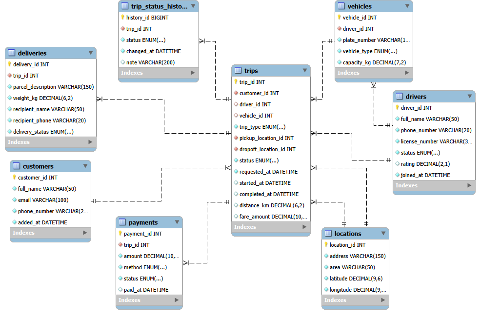

# Portfolio 1: Database Design and Modelling

## 1. Case Study

**InsightMove** is a simulated Lagos-based platform offering passenger ride-hailing and goods delivery on the same fleet. Customers request a trip (ride or delivery); the nearest suitable driver and vehicle is assigned; the trip moves through status stages until completed and paid.

- **Users:** customers, drivers, dispatchers staff, finance staff, data analysts
- **Major data:** customers, drivers, vehicles, locations, trips, delivery details, trip status history, payments
- **Key operations:** request and match a trip, update trip and delivery status, track a delivery, record payment, calculate driver earnings, report on delivery times and cancellations

## 2. ER Diagram

**Relationships**

| Relationship | Type | How it is enforced |
|---|---|---|
| customers → trips | One-to-many | `trips.customer_id` foreign key |
| drivers → vehicles | One-to-many | `vehicles.driver_id` foreign key |
| drivers → trips | One-to-many | `trips.driver_id` foreign key (nullable until accepted) |
| vehicles → trips | One-to-many | `trips.vehicle_id` foreign key (nullable until assigned) |
| locations → trips | One-to-many (twice) | `pickup_location_id` and `dropoff_location_id` foreign keys |
| trips → deliveries | One-to-one (optional) | `deliveries.trip_id` is a foreign key and `UNIQUE` |
| trips → trip_status_history | One-to-many | `trip_status_history.trip_id` foreign key |
| trips → payments | One-to-many | `payments.trip_id` foreign key |

## 3. Tables

### customers
| Column | Type | Constraints | Purpose |
|---|---|---|---|
| customer_id | INT | PRIMARY KEY, AUTO_INCREMENT | Unique ID generated by MySQL |
| full_name | VARCHAR(50) | NOT NULL | Customer's name |
| email | VARCHAR(100) | UNIQUE, NOT NULL | Contact email |
| phone_number | VARCHAR(20) | UNIQUE, NOT NULL | Contact number |
| added_at | DATETIME | NOT NULL, DEFAULT CURRENT_TIMESTAMP | When the customer signed up |

### drivers
| Column | Type | Constraints | Purpose |
|---|---|---|---|
| driver_id | INT | PRIMARY KEY, AUTO_INCREMENT | Unique ID generated by MySQL |
| full_name | VARCHAR(50) | NOT NULL | Driver's name |
| phone_number | VARCHAR(20) | UNIQUE, NOT NULL | Contact number |
| license_number | VARCHAR(30) | UNIQUE, NOT NULL | Driver's licence, one per driver |
| status | ENUM('available','on_trip','offline') | NOT NULL, DEFAULT 'offline' | Current availability |
| rating | DECIMAL(2,1) | NULL, CHECK 1.0 to 5.0 | Average rating; empty for new drivers |
| joined_at | DATETIME | NOT NULL, DEFAULT CURRENT_TIMESTAMP | When the driver joined the platform |

### vehicles
| Column | Type | Constraints | Purpose |
|---|---|---|---|
| vehicle_id | INT | PRIMARY KEY, AUTO_INCREMENT | Unique ID |
| driver_id | INT | NOT NULL, FOREIGN KEY → drivers | Owner of the vehicle |
| plate_number | VARCHAR(15) | UNIQUE, NOT NULL | Registration plate |
| vehicle_type | ENUM('bike','car','van') | NOT NULL | Type of vehicle |
| capacity_kg | DECIMAL(7,2) | NOT NULL, CHECK > 0 | Load capacity |

### locations
| Column | Type | Constraints | Purpose |
|---|---|---|---|
| location_id | INT | PRIMARY KEY, AUTO_INCREMENT | Unique ID |
| address | VARCHAR(150) | NOT NULL | Street address |
| area | VARCHAR(50) | NOT NULL | Area, e.g. Ikeja or Lekki |
| latitude | DECIMAL(9,6) | NOT NULL, CHECK -90 to 90 | Coordinate |
| longitude | DECIMAL(9,6) | NOT NULL, CHECK -180 to 180 | Coordinate |

### trips
| Column | Type | Constraints | Purpose |
|---|---|---|---|
| trip_id | INT | PRIMARY KEY, AUTO_INCREMENT | Unique ID |
| customer_id | INT | NOT NULL, FOREIGN KEY → customers | Who requested the trip |
| driver_id | INT | NULL, FOREIGN KEY → drivers | Assigned driver |
| vehicle_id | INT | NULL, FOREIGN KEY → vehicles | Assigned vehicle |
| trip_type | ENUM('ride','delivery') | NOT NULL | Passenger or goods |
| pickup_location_id | INT | NOT NULL, FOREIGN KEY → locations | Pickup place |
| dropoff_location_id | INT | NOT NULL, FOREIGN KEY → locations | Drop-off place |
| status | ENUM('requested','accepted','in_progress','completed','cancelled') | NOT NULL, DEFAULT 'requested' | Current stage |
| requested_at | DATETIME | NOT NULL, DEFAULT CURRENT_TIMESTAMP | When requested |
| started_at | DATETIME | NULL | When the trip began |
| completed_at | DATETIME | NULL | When the trip ended |
| distance_km | DECIMAL(6,2) | NULL | Distance travelled |
| fare_amount | DECIMAL(10,2) | NULL, CHECK >= 0 | Fare charged |

Table-level rule: `CHECK (pickup_location_id <> dropoff_location_id)`.

### deliveries
| Column | Type | Constraints | Purpose |
|---|---|---|---|
| delivery_id | INT | PRIMARY KEY, AUTO_INCREMENT | Unique ID |
| trip_id | INT | NOT NULL, UNIQUE, FOREIGN KEY → trips (ON DELETE CASCADE) | The delivery trip |
| parcel_description | VARCHAR(150) | NOT NULL | What is being delivered |
| weight_kg | DECIMAL(6,2) | NOT NULL, CHECK > 0 | Parcel weight |
| recipient_name | VARCHAR(50) | NOT NULL | Who receives it |
| recipient_phone | VARCHAR(20) | NOT NULL | Recipient contact |
| delivery_status | ENUM('pending','picked_up','in_transit','delivered','failed') | NOT NULL, DEFAULT 'pending' | Parcel status |

### trip_status_history
| Column | Type | Constraints | Purpose |
|---|---|---|---|
| history_id | BIGINT | PRIMARY KEY, AUTO_INCREMENT | Unique ID |
| trip_id | INT | NOT NULL, FOREIGN KEY → trips (ON DELETE CASCADE) | The trip |
| status | ENUM (same five values as trips) | NOT NULL | Status at that moment |
| changed_at | DATETIME | NOT NULL, DEFAULT CURRENT_TIMESTAMP | When it changed |
| note | VARCHAR(200) | NULL | Optional comment |

### payments
| Column | Type | Constraints | Purpose |
|---|---|---|---|
| payment_id | INT | PRIMARY KEY, AUTO_INCREMENT | Unique ID |
| trip_id | INT | NOT NULL, FOREIGN KEY → trips | The trip paid for |
| amount | DECIMAL(10,2) | NOT NULL, CHECK > 0 | Amount paid |
| method | ENUM('cash','card','transfer','wallet') | NOT NULL | Payment method |
| status | ENUM('pending','successful','failed','refunded') | NOT NULL, DEFAULT 'pending' | Payment state |
| paid_at | DATETIME | NULL | When payment succeeded |

## 4. Design Choices

- **Surrogate primary keys:** every table uses an auto-generated `_id`. Phone numbers and emails can change, and changing a key would mean updating every table that references it.
- **UNIQUE and NOT NULL on contact details:** dispatchers must be able to reach every customer and driver, and a repeated phone or email would suggest a duplicate account.
- **No address on customers:** customers are picked up and delivered to many places, so places live in `locations` and are referenced by trips.
- **VARCHAR lengths:** phone numbers need at most about 14 characters, so 20 is enough; emails can be long, so 100 is safer.
- **ENUM for fixed value sets:** status, trip type, vehicle type and payment method accept only the listed values.
- **Nullable columns in trips:** driver, vehicle, start time, completion time, distance and fare are unknown when a customer first requests a trip.
- **Separate deliveries table:** parcel fields apply only to delivery trips, so keeping them out of `trips` avoids empty columns on every ride.
- **Separate trip_status_history:** `trips.status` is overwritten at each change; the history table keeps the full audit trail.
- **ON DELETE CASCADE only on deliveries and history:** these records mean nothing without their trip. Payments have no cascade, so a trip with payments can't be deleted by accident.
- **DECIMAL for money and coordinates:** exact values, with no rounding errors as with FLOAT or truncation as with INT.
- **Known limitation:** nothing stops a trip from using a vehicle that belongs to a different driver. A composite foreign key `(vehicle_id, driver_id)` could enforce this.

## 5. AI Use Declaration
- **Tool:** Claude (Anthropic)
- **Used for:**to ask details about some syntax error
